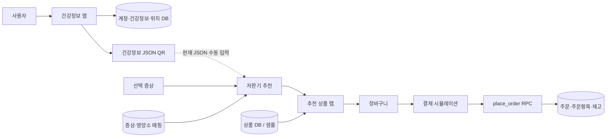

> 최신 상태는 [STATUS.md](STATUS.md), QR 규격은 [QR_PROTOCOL.md](QR_PROTOCOL.md)를 우선합니다. 아래 내용은 이전 분석/검토 기록이며 현재 배포 완료를 의미하지 않습니다. QR은 단일 숫자 코드, 결제는 제외입니다.

# 영양제 자판기·건강정보 앱 코드 분석

분석일: 2026-10-14 (한국 시간)  
대상: `chailkown/vitamin-vending-machine`, `main`  
커밋: `69641eca6b2df14ef26dc412e24f7c218d6805d3` (`Initial capstone app and kiosk`)  
체크아웃: `C:\Users\차일권\OneDrive\Desktop\chailgwon\ss`

## 1. 무엇을 만드는 프로젝트인가

**개인 건강정보와 선택 증상을 이용해 영양제를 추천하고, 자판기에서 1회분 파우치 단위로 구매하는 졸업작품 시스템**이다. 저장소에는 자판기용 React 앱, 개인용 React 웹앱, 그 웹앱을 Android에 담는 Capacitor 프로젝트, Supabase SQL이 함께 있다. (2026-10-14 실제 하드웨어 단위 정정. 아래 분석은 수정 전 커밋 기준이며 최신 수정은 CHANGE_REPORT.md 참조.)

기능을 연결하면 다음과 같다.

1. 사용자가 건강정보 앱에서 회원가입하고 신체정보·흡연·음주·질환·알레르기·복용약을 입력한다.
2. 앱이 정보를 작은 JSON 필드로 변환하고 QR을 생성한다.
3. 자판기에서 증상을 선택하고 QR 데이터를 전달한다.
4. 증상별 영양소에 개인별 추가·제외 규칙을 적용한다.
5. 추천 상품 목록에서 사용자가 장바구니에 담고 결제 수단을 선택한다.
6. DB 설정 시 PostgreSQL 함수가 주문·주문항목을 저장하고 재고를 차감한다.

**현재 실제 구현 범위:** 화면·정적 추천·상품 조회·주문 RPC·건강정보 저장·지도와 위치 관리 UI·Android 래퍼. 카메라 QR 인식, 결제 승인, 자판기 모터/배출 제어는 구현돼 있지 않다. QR은 자판기에 JSON을 붙여넣는 방식이고 결제는 1.5초 대기 후 주문을 만드는 시뮬레이션이다. 별도 Node/Java 서버는 없다. Java 클래스는 Capacitor 진입점이다.

추천은 머신러닝 모델이 아니라 **증상 매핑과 조건문으로 이루어진 규칙 기반 알고리즘**이다. 본 문서는 코드의 동작을 분석하며, 코드에 적힌 효능·질환별 규칙의 의학적 타당성을 검증한 문서는 아니다.

## 2. 구성과 데이터 흐름

| 영역 | 기술 | 역할 |
|---|---|---|
| `frontend` | React 19, Create React App 5, Supabase JS | 자판기 UI |
| `health-app-web` | React 19, Vite 8, fetch REST | 개인 건강정보·QR·지도·관리자 UI |
| `health-app-web/android` | Capacitor 8, Java, Gradle | 개인 앱의 Android 패키징 |
| `frontend/supabase` | PostgreSQL SQL·PL/pgSQL | 영양소·증상·상품·주문 |
| `health-app-web/supabase` | PostgreSQL SQL | 계정·건강정보·QR 이력·자판기 위치 |

두 앱은 독립적인 번들이다. 각자의 `.env`와 포트, 의존성 설치가 필요하다. 앱 DB와 자판기 DB를 같은 Supabase 프로젝트에 생성하더라도 자동으로 기능이 연결되지는 않는다. 자판기는 `app_qr_payloads`를 조회하지 않고, 사용자가 전달한 JSON 자체를 신뢰한다.

## 3. 자판기: 파일별 분석

### `frontend/src/index.js`, `App.js`, `App.css`, `index.css`

`index.js`가 React root를 만든다. `App.js`는 `currentScreen`을 `main/purchase/recommend` 중 하나로 유지하며 해당 컴포넌트만 렌더링한다. `purchaseRecommend`로 추천 결과를 구매 화면에 넘긴다. 직접 구매를 누르면 과거 추천을 초기화한다.

화면 전환은 URL 라우팅이 아니라 메모리 상태다. 새로고침하면 메인으로 돌아가고 화면이 언마운트되면 장바구니도 사라진다. 브라우저 뒤로가기와 화면 이동이 연결돼 있지 않다. `App.css`의 `.App`은 현재 JSX에 사용되지 않는다. `index.css`는 root 높이와 글꼴을 설정한다.

### `pages/MainScreen.js`

직접 구매와 맞춤 추천 버튼을 제공한다. `currentTime`을 1초마다 갱신하지만 화면에서 사용하지 않고 `formatTime`도 호출하지 않는다. 결과적으로 표시할 필요가 없는 시계 때문에 메인 화면이 계속 재렌더링된다. 타이머 해제는 구현돼 있다.

### `pages/PurchaseScreen.js`

초기 상품 전체 조회 → 카테고리 추출 → 첫 카테고리 조회 순서다. 추천 ID가 있으면 `추천` 탭을 추가한다. 추천 결과는 장바구니에 자동으로 담기지 않고 별도 상품 목록으로 표시된다.

장바구니 구조는 `{ product, qty }[]`이고 상품 ID로 중복을 합친다. 금액은 브라우저의 상품 가격 × 수량으로 계산한다. 수량 감소는 `Math.max(1, ...)` 때문에 1 아래로 내려가지 않으며 삭제 버튼을 따로 사용한다. 수량 증가에 재고 상한은 없다. 재고가 정확히 0인 상품의 담기만 막는다.

결제 성공 후 장바구니를 비우고 상품을 다시 읽는다. 다만 `loadVitamins`가 첫 카테고리로 상태를 설정하는 동시에 `handlePay`가 이전 `activeCategory`를 다시 조회할 수 있어 선택 탭과 표시 상품이 어긋날 여지가 있다. 카테고리를 빠르게 전환할 때 이전 요청 응답을 무시하는 처리도 없다.

`fetchError` 상태를 저장하지만 JSX 어디에도 출력하지 않는다. 샘플/DB 상태 안내용 CSS는 있어도 실제 안내 UI가 없다. 사용자는 DB 실패와 샘플 사용을 구분하기 어렵다. effect 의존성이 충분하지 않고, 요청 취소·실패 UI·가격 갱신 안내가 부족하다.

### `pages/RecommendScreen.js`

추천 카탈로그를 읽고 대분류 → 세부 증상 → 영양소·설명·주의사항·상품을 보여준다. `buildCombo`가 구매 화면에 넘길 객체를 만든다.

QR가 없으면 증상 기반 추천이다. QR가 있으면 기존 영양소와 추가 규칙을 합집합으로 묶고 제외 영양소를 뺀다. 제외가 추가보다 우선한다. QR로 새롭게 추가한 영양소의 주의사항을 별도로 가져오지는 않아 안내 패널의 주의사항이 빠질 수 있다.

이름에 `scan`이 있지만 카메라 접근은 없다. `textarea`의 JSON을 파싱한 뒤 900ms 타이머로 처리하는 연출이다. 기본값에는 특정 개인을 나타내는 데모 프로필이 들어 있다. 타이머 정리·비동기 오류 처리·중복 진행 방지가 충분하지 않다. 증상을 연달아 선택하면 늦게 도착한 이전 응답이 현재 표시를 덮어쓸 수 있다.

조합을 만드는 동안 카탈로그와 상품을 여러 번 조회한다. 초기 카탈로그, 증상 메타 조회, 상품 ID 조회 과정에서 같은 데이터를 재조회하므로 DB 상태가 바뀌면 서로 다른 시점의 데이터가 한 결과에 섞일 수 있다.

### `components/PaymentModal.js`

`select → processing → success/error` 상태로 진행한다. 카드·모바일·현금은 UI 선택값이며 결제 SDK나 단말기와 연결되지 않는다. 성공 화면의 “제품이 배출됩니다”는 문구일 뿐 배출 명령이 없다.

처리 중에도 닫기 버튼을 누를 수 있다. 닫기가 비동기 작업을 취소하지 않으므로 닫은 뒤에도 주문이 만들어질 수 있다. 곧바로 다시 열어 결제하면 이전 작업과 새 작업이 동시에 진행될 수 있다. 서버에도 멱등성 키가 없어 중복 주문을 막을 수 없다. 이 부분은 실제 결제와 연결하기 전에 수정해야 한다.

### `config/supabase.js`

두 환경변수를 trim한 뒤 둘 다 있으면 클라이언트를 생성한다. 없으면 `null`이다. **현재 코드에는 URL/키의 하드코딩 폴백이 없다.** 기존 `PROJECT_CHECK.md`의 해당 설명은 낡았다. 변수가 비어 있지 않은지만 확인하므로 예제의 미완성 키를 그대로 쓰면 “설정됨”으로 간주하지만 실제 요청은 실패할 수 있다.

### `services/vitaminService.js`

전체·ID·카테고리·검색·관리용 CRUD를 제공한다. 조회에는 활성 상품 필터와 영양소 join이 붙는다. 상품 정규화에서 이름·이미지·설명·가격을 보정한다. 가격을 무조건 최소 1원으로 만드는 처리는 잘못된 데이터를 정상 상품처럼 숨길 수 있다.

주요 문제는 `getVitaminsByCategory`: 샘플을 카테고리로 필터링한 후 결과가 있으면 `useSample()`을 호출하는데, 이 함수는 전체 샘플을 반환한다. **DB가 없을 때 모든 카테고리가 전체 24개 상품을 표시한다.** 실제 재현했다.

`REACT_APP_USE_SAMPLE_FALLBACK=false`는 전체 조회에 적용되지만 ID 조회·검색 및 일부 catch 경로에서는 샘플이 반환된다. 플래그를 끈 뒤에도 ID 1 상품을 받는 것을 확인했다. 추천 카탈로그도 이 플래그와 별개로 샘플로 내려간다.

데이터 출처·오류는 모듈 전역 변수여서 여러 요청의 상태를 정확히 나타내기 어렵다. 검색어를 PostgREST `or` 식에 그대로 넣으므로 특수 문자가 필터 문법에 영향을 줄 수 있다. 관리자 CRUD 함수가 존재하지만 관리자 상품 UI는 없으며 제공 SQL에는 상품 쓰기 정책도 없다. 서비스 함수 존재만으로 상품 관리가 작동하지 않는다.

### `services/recommendationService.js`

DB 카탈로그 우선, 실패하면 `algorithmData`를 사용하는 구조다. 추천 영양소 이름과 상품 `category` 문자열이 같아야 매칭된다. 상품 선택은 ID 순 조회 결과에서 영양소별 처음 두 개다. 가격·함량·나이·성별·품절 여부를 비교해 순위를 정하지 않는다.

개인 프로필은 흡연·음주·단일 질환·단일 알레르기·단일 약물·BMI에 조건문을 적용한다. 나이와 성별은 전달되지만 현재 추천 규칙에서 사용하지 않는다. BMI 계산에만 키·체중을 사용한다. 규칙의 추가/제외 동작과 의료적 정확성은 구분해야 한다.

`parseQrPayload`는 JSON 문법만 검사한다. `null`, 배열, 숫자, 빈 객체도 기본값 프로필로 바뀌어 성공한다. 음수나 비현실적인 수치, 알 수 없는 코드, 발급자·서명·만료 정보 검증도 없다. `toInt`라는 이름과 달리 소수값도 허용한다.

### `services/orderService.js`

장바구니를 상품 ID·수량으로 줄여 RPC에 전달한다. 가격을 서버에서 결정하도록 한 것은 좋은 선택이다. 결제 수단 인자가 없는 구버전 RPC로 재시도하는 호환 코드도 있다. 다만 구버전 성공 시 사용자가 선택한 결제 수단은 DB에 보존되지 않을 수 있다.

DB 미설정이면 `ok:true, offline:true`를 반환한다. 주문 저장도 재고 차감도 없지만 UI에는 정상 결제 완료가 표시된다. RPC 성공 시 영수증 금액은 서버 결과가 아니라 기존 장바구니 가격으로 계산한다. 주문 직전에 DB 가격이 바뀌면 저장 금액과 표시 금액이 달라질 수 있다. 서버가 주문 ID뿐 아니라 확정 금액·수량을 반환해야 한다.

### `data/algorithmData.js`, `data/sampleVitamins.js`

영양소 12개, 증상 대분류 7개, 세부 증상 22개, 상품 24개를 포함한다. 상품은 각 영양소에 2개씩 대응한다. 가격은 1회분 파우치당 가격으로 정정한다. DB seed와 JS 데이터를 수작업으로 중복 관리하므로 변경 시 불일치 위험이 있다.

샘플에는 재고가 없어서 오프라인 시연에서 품절·수량 제한을 표현하지 못한다. 상품 이미지 경로 24개가 실제로 모두 존재함은 확인했다. 다만 일부 이미지 파일명은 D3 5000 IU인데 데이터 함량은 1000/2000 IU, Vitamin C 이미지 파일명은 1000mg인데 데이터는 500mg이다. **이미지 파일명과 데이터가 어긋남은 확정이며 실제 포장 라벨 판독은 이번 범위에서 하지 않았다.**

### 스타일 4개

| 파일 | 역할과 관찰 |
|---|---|
| `styles/MainScreen.css` | 큰 버튼·메인 화면·반응형. 고정 100vh와 overflow hidden, 큰 세로 여백으로 낮은 화면에서 잘릴 가능성 |
| `styles/PurchaseScreen.css` | 상품 2열·카테고리 탭·고정 장바구니·하단 버튼. 상품 아래 55vh 이상 여백을 확보하므로 실제 장바구니 높이에 비해 빈 공간이 클 수 있음 |
| `styles/RecommendScreen.css` | 카테고리·추천 카드·모달. 같은 선택자 반복 정의가 많아 뒤쪽 규칙이 앞쪽을 덮음. QR 모달 고정 폭 640px은 작은 화면에서 점검 필요 |
| `styles/PaymentModal.css` | 결제 오버레이·단계·스피너. max-height와 내부 스크롤은 구현됨 |

CRA에서 CSS는 전역으로 적용된다. `.purchase-btn`이 메인과 구매 화면에서 중복 정의돼 로딩 순서에 따라 스타일이 영향을 받는다. 화면별 부모 선택자나 CSS Module로 범위를 제한하는 편이 안전하다. 키보드로 조작할 탭·카테고리가 클릭 가능한 div이고 모달 focus trap이 없어 접근성 보완도 필요하다. 레이아웃 위험은 CSS 정적 분석이며 실기기 렌더링 결과는 아니다.

## 4. 자판기 DB: SQL별 분석

### `schema.sql`

`nutrients → vitamins`, `symptom_categories → symptoms`, `symptoms ↔ nutrients`를 만든다. 마지막 다대다 관계는 `symptom_nutrients`다. 상품은 양수 가격과 음수가 아닌 재고 제약, 활성 플래그, 갱신 시각 트리거를 갖는다. 카탈로그는 공개 읽기, 상품은 활성 행만 공개 읽기를 허용한다.

상품의 `nutrient_id`와 별도 문자열 `category`는 같은 의미를 중복 저장한다. 둘이 다르면 추천 매칭이 잘못될 수 있다. `category`가 있으면 서비스는 영양소 이름보다 그것을 우선한다.

### `seed.sql`

12/7/22/24개 마스터를 고정 ID로 입력하고 identity sequence를 최신 ID에 맞춘다. 다시 실행하면 단순히 없는 데이터만 추가하는 게 아니다. 증상 매핑을 모두 지웠다 다시 만들고, 기존 상품 재고를 100으로 되돌리며 비활성 상품을 다시 활성화한다. 운영 DB에서 재실행하면 판매 기록과 재고 현실이 어긋난다. 초기 데이터 설치와 운영 데이터 갱신을 분리해야 한다.

### `orders_schema.sql`, `payment_schema.sql`

주문 헤더·품목을 만들고 `place_order`가 상품 검증 → 총액 계산 → 주문 저장 → 품목 저장 → 재고 차감을 수행한다. 결제 SQL은 결제 수단 컬럼과 3인자 RPC로 확장한다. 함수의 예외는 같은 트랜잭션 안의 변경을 롤백한다. 서버 가격 사용·양수 수량 검사·재고 CHECK는 장점이다.

운영에 중요한 한계:

- 익명 호출자도 `SECURITY DEFINER` RPC로 결제 증빙 없이 완료 주문을 만들고 재고를 차감할 수 있다.
- 주문과 주문품목 공개 읽기가 `using(true)`라서 주문 금액·품목·추천 메모가 모든 익명 호출자에게 노출된다.
- 재고 검증 SELECT에 행 잠금이 없고 검증·차감이 분리돼 있다. 동시 주문이 같은 재고를 통과한 뒤 한쪽이 CHECK 오류로 실패할 수 있다. CHECK가 있으므로 이를 단순히 “음수 재고 허용”이라고 부르면 부정확하다.
- 같은 상품 ID를 여러 줄로 제출하면 합산 수량 검증이 아닌 개별 검증이다. 최종 제약으로 실패하더라도 친절한 사전 검증이 안 된다.
- 여러 상품을 서로 다른 순서로 갱신하면 잠금 순서가 달라 데드락 가능성이 있다.
- 가격을 두 차례 SELECT하므로 중간 가격 변경 시 헤더 합계와 품목 합계가 달라질 수 있다.
- 요청 ID, 결제 승인 ID, 자판기 ID, 사용자 ID, 배출 결과와 환불 흐름이 없다.

개선 방향은 입력 품목 합산 → 고정 순서로 행 잠금 → 검증 시 가격 스냅샷 확정 → 결제 승인 검증 → 멱등한 주문 생성이다. 실제 단말기 결제와 배출을 연결하면 `pending/paid/dispensing/dispensed/failed/refunded`처럼 처리 상태도 분리해야 한다.

### `migrate_from_v1.sql`

영양소·증상·상품 테이블을 `DROP ... CASCADE`로 지운다. 데이터 보존형 마이그레이션이 아니다. 주문 테이블이 있는 DB에서 실행하면 FK 등 종속 객체도 제거될 수 있다. 이번 분석에서는 어떤 SQL도 실행하지 않았다.

## 5. 건강정보 앱: 파일별·기능별 분석

### `src/main.jsx`, `App.jsx`

`main.jsx`는 StrictMode로 App을 감싼다. `App.jsx` 하나에 로그인, 회원가입, 프로필, 건강정보 입력, 질환/알레르기/약물 선택, QR, 지도, 관리자 위치 CRUD, 여러 공통 UI가 들어 있다. 파일이 약 1,170줄로 UI·인증·저장·지도·QR 책임이 한곳에 모여 있다.

#### 인증과 권한

`USERS_KEY`에 `{userId,password,name}` 배열을 저장하며 DB도 `password text`를 사용한다. 로그인은 DB에서 받은 비밀번호와 브라우저 입력을 직접 비교한다. Supabase Auth 세션·서버 검증·암호 해싱이 없다. localStorage 세션의 `isAdmin`을 바꾸면 관리자 화면으로 진입할 수 있다.

기본 관리자 판정은 `userId === 'admin'`이고, DB 로그인 성공 시 `app_admins` 조회로 덮어쓴다. **제공 SQL에는 `app_admins`가 없다.** DB 조회 실패가 catch로 숨겨지고 이전 판정이 남을 수 있다. 오프라인에서는 `admin` 계정을 스스로 만들고 그 이름으로 관리자 진입이 가능하다. 화면 권한보다 더 큰 문제는 DB 쓰기 정책 자체가 공개라는 점이다.

회원가입 DB 요청이 실패해도 로컬 회원가입을 완료할 수 있다. DB 로그인 실패 후에도 캐시 계정이 유효하면 로그인된다. 실제 사용자 인증과 오프라인 시연의 경계가 불명확하고 서버의 계정 변경을 로컬 캐시가 우회할 수 있다.

#### 건강정보와 저장

나이 1~120, 키 80~230, 체중 20~200의 정수 범위를 검사한다. 질환은 복수 선택할 수 있다. 알레르기와 약물은 프리셋 또는 직접 입력이다.

**새로고침 시 저장값 손실:** 초기 profile은 공통 키 `health-app-profile-v1`을 읽는데 저장은 `health-app-profile-v1-사용자ID`로 한다. 세션이 남은 상태로 새로고침하면 기본/공통 프로필이 활성 사용자의 키에 자동 저장된다. 시작 시 사용자별 프로필을 복원하는 절차도 없다. 연결 DB에 이전 값이 있을 수는 있지만 새로고침 때 이를 조회해 복원하지 않는다. 저장 키 불일치와 덮어쓰기 경로를 재현 모델로 확인했다.

프로필 변경마다 effect가 자동으로 로컬에 저장하므로 “저장하기”를 누르지 않은 편집도 남는다. 저장 버튼은 유효성 검사·DB 전송·설정 완료 처리에 가깝다. 초안과 확정값을 분리해야 한다.

필수 설정은 뒤로 버튼만 막는다. 아래 메뉴·홈·마이페이지 버튼은 살아 있어 빈 프로필 상태로 다른 화면에 갈 수 있다. `SelectField`의 초기 value는 빈 문자열인데 빈 선택 option이 없어 표시되는 선택지와 실제 상태가 달라질 수 있다. 첫 옵션을 명시적으로 선택하지 않은 상태에서 필수값 검사에 걸릴 수 있다.

#### QR payload

| 필드 | 의미 | 전달 형태 |
|---|---|---|
| `id` | 사용자 ID | 문자열 |
| `n` | 이름 | 문자열 |
| `a` | 나이 | 숫자 |
| `g` | 성별 | M/F |
| `h`, `w` | 키·체중 | 숫자 |
| `s` | 흡연 | 0/1 |
| `al` | 음주 | 0~3 |
| `c` | 질환 | 0~7, 기타 99 |
| `ag` | 알레르기 | 0~5, 기타 99 |
| `m` | 약물 | 0~5, 기타 99 |

`toFirstCode`는 배열의 첫 항목만 사용한다. 두 질환을 선택해도 두 번째 질환은 자판기에 전달되지 않는다. 직접 입력한 알레르기·약물은 99로 바뀌지만 자판기에는 99 대응 규칙이 없다. 이 경우 아무 제한도 없는 프로필처럼 처리될 수 있다. 정보 손실과 미지원 상태를 명시해야 한다.

30초 카운트다운은 0 직전에 30으로 돌아간다. QR 새로고침도 카운트다운만 초기화한다. payload는 그대로이며 시간·토큰·서명 정보가 없다. DB의 발급 이력 만료값과 표시 QR은 연결되지 않는다. 현재 QR은 **30초마다 바뀌는 일회용 인증 QR이 아니라 고정 건강정보 QR**이다.

QR 행렬을 QR 화면이 아닌 App 최상위에서 항상 계산한다. 이름/아이디가 길어 고정 QR 용량을 넘으면 건강정보 편집 중에도 예외가 App 렌더링을 중단할 수 있다. 길이 제한·예외 표시가 없다.

#### 지도와 관리자

카카오 SDK를 동적으로 로드하고 자판기 좌표에 마커를 표시한다. 중심은 고정된 서원대 근처이며 기기 현재 위치를 읽지 않는다. 가장 가까운 자판기 찾기·경로 안내·거리 계산은 구현되지 않았다.

관리자가 위치를 클릭하면 좌표를 읽고 역지오코딩으로 주소를 채운다. 좌표 변경이 지도 effect 의존성이므로 클릭할 때 지도가 다시 생성돼 중심이 초기화될 수 있다. async 주소 응답도 이전 클릭 결과가 나중에 도착해 덮어쓸 수 있다.

좌표 빈 문자열은 `Number('') === 0`이므로 “좌표 미선택” 검사를 통과한다. 위도·경도의 범위 검사도 없다. DB 저장·삭제 실패에도 성공 문구를 표시하며 로컬 값을 먼저 바꾼다. 다시 로그인하면 DB 상태가 재반영될 수 있다. DB 자판기 목록이 0개이면 기본/로컬 목록을 비우지 않기 때문에 모두 삭제된 상태도 정확하게 표현하지 못한다.

### `src/services/healthDb.js`

Supabase JS 라이브러리 대신 REST API에 fetch한다. 익명 키를 apikey와 Bearer 헤더로 사용하며 실제 사용자 로그인 토큰은 없다. `findAppUser/findAppAdmin`, 사용자 생성, 프로필 upsert, QR 이력 insert, 자판기 CRUD, DB 행 변환 함수를 제공한다.

`saveHealthProfile`은 프로필 저장 후 QR 이력을 별도 요청으로 저장한다. 두 요청이 한 트랜잭션이 아니므로 앞은 성공하고 뒤는 실패할 수 있다. QR 발급 이력은 QR 화면을 열 때가 아니라 건강정보 저장 시점에만 생긴다.

`payload_hash`는 JSON을 Base64로 인코딩한 앞 120글자다. 해시도 서명도 아니고 입력이 같으면 같으며 앞부분이 같으면 충돌할 수 있다. 만료는 저장만 하고 자판기에서 검사하지 않는다. 오류가 위쪽 UI에서 대부분 무시돼 데이터가 서버에 저장됐는지 알기 어렵다.

### `src/qrVersion6.js`

외부 QR 라이브러리 없이 직접 구현했다. version 6, 41×41, L 오류정정, 데이터 136 codeword, 2블록, 블록당 18 ECC, mask 0 고정이다. UTF-8 바이트 인코딩 → Reed–Solomon → 블록 인터리브 → 위치 패턴 → 데이터 배치 → format bits 순이다. `qrMatrixToDataUrl`도 있으나 현재 앱은 CSS grid로 1,681개 span을 표시한다.

**오류정정 계산 오류를 확인했다.** generator는 상수항 우선으로 계수를 만들지만 remainder는 최고차항 우선의 shift 연산 형태로 사용한다. 데이터 0~67의 한 블록에 계산한 ECC를 붙여 GF(256) 근에서 syndrome을 평가하면 18개 중 17개가 0이 아니다. 유효한 RS codeword는 모두 0이어야 한다. 즉 정사각 행렬이 생성된다고 올바른 QR이라는 뜻이 아니다.

format bits도 첫 복사본의 행/열 배치가 일반 QR 배치와 전치된 형태여서 추가 확인이 필요하다. 이번 검증은 RS 수학적 검사이며 실제 카메라 디코더 성공률을 측정한 결과가 아니다. 권장 조치는 검증된 QR 라이브러리로 교체하고 한국어 JSON을 독립 디코더로 왕복 검증하는 것이다.

용량 초과 검사 자체는 있으나 App에서 예외를 처리하지 않는다. 현재 byte mode 구조에서 135 ASCII 바이트는 예외를 던진다. 한글은 UTF-8에서 여러 바이트를 사용하므로 글자 수와 바이트 수를 구분해야 한다. mask 최적 선택과 UTF-8 ECI 처리는 구현돼 있지 않다.

### `src/App.css`, `index.css`, assets·public

App.css는 색상 변수, 430px 모바일 프레임, 입력·카드·지도·QR·관리자·하단 메뉴를 정의한다. safe-area padding과 100dvh를 사용한다. 프레임에 overflow hidden을 걸고 일반 입력/프로필 영역에 스크롤을 제공하지 않아 작은 높이와 키보드 표시 상태에서 입력·저장 버튼이 가려질 가능성이 있다. 관리자 영역에는 스크롤이 있다.

index.css는 기본 글꼴이다. hero/react/vite 이미지 자산은 App 코드에서 참조하지 않는다. public favicon은 HTML에서 사용하고 icons.svg는 주 UI의 직접 참조가 없다. `index.html`의 lang은 영어이고 타이틀은 템플릿 이름이라 한국어 서비스에 맞춰 정리할 부분이다.

## 6. 건강정보 DB: `app_schema.sql`

계정 `app_users`, 프로필 `app_health_profiles`, QR 이력 `app_qr_payloads`, 위치 `app_vending_machines` 4개 테이블과 기본 위치 3개를 만든다. 사용자 ID FK와 프로필 숫자 범위 제약은 있다. 프로필 updated_at 자동 트리거는 없고 클라이언트가 시간을 보낸다.

**가장 높은 우선순위의 문제:** 네 테이블의 정책이 `for all to anon, authenticated using(true) with check(true)`다. 표준 Supabase 테이블 권한이 부여된 환경에서 누구나 모든 계정·평문 비밀번호·건강정보를 읽거나 수정·삭제할 수 있도록 허용한다. RLS를 켰다는 사실만으로 보호되지 않는다. 실제 원격 DB에 이 SQL이 적용됐는지는 확인하지 않았다.

계정은 Supabase Auth 등 서버 인증으로 옮기고 프로필/QR 이력은 사용자 본인만, 위치는 공개 읽기와 서버에서 확인한 관리자 쓰기로 정책을 나눠야 한다. 프론트의 `isAdmin`은 DB 권한 근거가 될 수 없다. `app_admins`를 별도로 만들더라도 공개 조회나 로컬 판정으로만 권한을 확인하면 문제는 해결되지 않는다.

주문 DB와 건강정보 DB 사이 FK가 없으므로 현재 앱의 사용자에게 자판기 구매 이력을 연결할 수 없다. 자판기 위치와 상품 재고도 연결되지 않아 여러 자판기의 독립 재고를 관리하지 못한다.

## 7. 빌드·설정·Android 파일

| 파일/그룹 | 내용과 분석 |
|---|---|
| `frontend/package.json` | CRA start/build/test, DB 조회·주문 검사 명령. `web-vitals`는 현재 엔트리에서 사용하지 않음 |
| `health-app-web/package.json` | dev 3001, Vite build, lint, Android init/sync/open. Capacitor가 devDependencies에 있으므로 production-only 설치로 Android 빌드 준비는 부족 |
| 두 `package-lock.json` | 앱별 의존성 잠금. 루트 package/workspace 설정은 없어 한 번에 두 앱을 실행하는 스크립트는 없음 |
| `vite.config.js` | React plugin과 `base:'./'`로 모바일 번들 상대 경로 설정 |
| `eslint.config.js` | JS·React Hooks·Refresh 규칙. Android/dist 제외. 오류를 숨긴 catch, 긴 effect 등은 실행 lint로 별도 점검 필요 |
| 두 `.env.example` | 각 앱의 Supabase 설정. 건강 앱 예제에는 publishable 키가 있고 자판기 예제는 미완성 JWT. 공개 클라이언트 키 자체와 DB 권한 문제는 구분해야 함 |
| `run-dev.bat` | 건강 앱 폴더에서 npm dev 호출. 현재 셸에는 Node/npm이 PATH에 없어서 환경 준비 필요 |
| `capacitor.config.json` | appId `com.capstone.healthapp`, webDir `dist`, Android https localhost |
| `android/app/.../MainActivity.java` | `BridgeActivity` 상속만 있는 래퍼. 카메라/센서/결제/배출 코드 없음 |
| `android/app/build.gradle` | 앱 ID·version·SDK·의존성·release 설정. release 최적화 비활성, 별도 배포 서명 설정 없음 |
| `android/build.gradle` | AGP 8.13.2와 Google Services plugin, 저장소 설정 |
| `android/variables.gradle` | min SDK 24, compile/target SDK 36, AndroidX·테스트 의존성 버전 |
| `android/settings.gradle`, `capacitor.settings.gradle` | app·Cordova bridge·node_modules Capacitor 프로젝트 연결 |
| `android/app/capacitor.build.gradle` | Java 21 설정과 생성 Cordova 변수 파일 참조 |
| `android/gradle/wrapper/*`, `gradlew*` | Gradle 8.14.3 wrapper. jar/bat/sh는 빌드 도구 자산 |
| `android/gradle.properties` | AndroidX 활성화, JVM 메모리 설정 |
| `AndroidManifest.xml` | INTERNET 권한, launcher Activity, FileProvider. CAMERA 권한 없음 |
| `res/values/*.xml` | 앱 이름·패키지명·테마·아이콘 배경색 |
| `res/layout/activity_main.xml` | WebView 컨테이너 |
| `res/xml/file_paths.xml` | 파일 공유 경로. 전체 external/cache 경로를 포괄하므로 실제 공유 기능 추가 시 범위를 좁힐 필요 |
| `res/drawable*`, `res/mipmap*` | 스플래시·런처 리소스. adaptive-icon XML이 배경·전경을 연결 |
| `proguard-rules.pro` | 템플릿 주석 위주. 앱 고유 로직 없음 |
| `ExampleUnitTest.java` | 2+2=4 템플릿 시험, 서비스 기능 검증 없음 |
| `ExampleInstrumentedTest.java` | 기대 패키지 `com.getcapacitor.app`가 실제 `com.capstone.healthapp`과 달라 현재 그대로는 실패할 조건 |

Android checkout에는 생성된 Cordova bridge 디렉터리와 웹 자산이 포함되지 않는다. 정상 준비는 의존성 설치 → `npm run android:sync` → Android 빌드 순서다. Java 21과 Android SDK가 필요하다. 웹 앱이 빌드된다고 APK가 검증된 것은 아니다.

## 8. 문서·그림·정적 자산

- `PROJECT_CHECK.md`: 초기 점검과 이후 추가 기록이다. “주문 TODO”, “Supabase 하드코딩 기본 키”, “앱 연동 다음 작업” 등은 현재 코드와 일부 불일치한다. 현재 상태를 다시 기술해야 한다.
- `frontend/DATABASE.md`: DB 설치 순서와 테스트 설명이다. 상품 20/24종 표현이 혼재하고 존재하지 않는 `npm run db:seed`를 안내한다. 최종 스키마에는 payment SQL까지 필요하다.
- `health-app-web/README.md`: Vite 기본 템플릿이다. 로그인·DB·QR·Kakao·Android 설정을 설명하지 않는다.
- `kiosk_db_relationship_diagram.svg`: 키오스크 데이터 관계 설명 자산이다. 런타임 코드와 연결되는 DB 정의는 SQL이다.
- 루트 `screen`과 `frontend/public/screen`: 같은 용도의 상품 이미지가 중복 존재한다. 런타임은 public 쪽을 사용한다.
- `ppt_extract/*.png`: 발표자료에서 추출한 이미지 자료로 보이며 앱 import 대상은 아니다. 파일명과 코드 참조 기준 판단이고 슬라이드 내용은 별도 OCR/시각 분석하지 않았다.
- 루트/앱/Android `.gitignore`: 의존성·빌드·환경변수·SDK 로컬 경로를 제외한다. APK나 실제 `.env`는 클론으로 가져오지 않는다.

## 9. 재현 확인 결과

재현 도구: `analysis/verify.mjs`  
원시 출력: `analysis/verification.txt`

네트워크·DB를 호출하지 않고 JS 데이터/서비스를 VM에 올리고 DB 미설정 stub으로 검사했다. React UI를 실제로 구동한 테스트와는 구분한다.

| 항목 | 결과 | 검증 방식 |
|---|---|---|
| 영양소·카테고리·증상·상품 개수 | 12 / 7 / 22 / 24 | 소스 평가 |
| 비타민 C 카테고리 오프라인 | 기대 2개, 실제 24개·12개 카테고리 | 서비스 직접 호출 |
| 비정상 QR 입력 | null / 배열 / 숫자 / 빈 객체 모두 ok | 파서 직접 호출 |
| DB 없는 주문 | ok:true, offline:true | 서비스 직접 호출 |
| 상품 이미지 | 경로 24개 모두 존재 | 파일 존재 검사 |
| QR 행렬 | 41×41 생성 | 함수 호출 |
| QR RS 오류정정 | syndrome 18개 중 17개 nonzero | GF(256) 근 평가 |
| QR 135 ASCII bytes | 용량 초과 예외 | 함수 호출 |
| 질환 2개 | 첫 질환 코드만 전달 | 실제 helper 평가 |
| 직접 입력 약물 | 99 | 실제 helper 평가 |
| 폴백 비활성 | 전체 조회 0개지만 단일 ID 조회 샘플 반환 | 서비스 직접 호출 |
| 새로고침 저장 키 | 기존 사용자 프로필을 빈 프로필로 덮는 경로 | 소스의 read/write 키를 적용한 모델 |

일반 `node`, `npm`은 현재 PATH에서 찾을 수 없었다. 번들 Node 실행 파일을 찾아 위 검증을 실행했다. 앱 의존성 설치·CRA/Vite 전체 빌드·ESLint·브라우저 렌더링·Android APK 빌드·원격 DB 적용 상태는 검증하지 않았다. 실제 환경변수도 제공되지 않았다. 특히 `db:test-order`는 실제 주문을 만들고 재고를 차감하므로 실행하지 않았다. 이 보고서에서 재현, 정적 확인, 가능성, 미검증 영역을 구분했다.

## 10. 우선순위와 다음 개발 순서

| 순서 | 작업 | 완료 조건 |
|---|---|---|
| 1 | 서버 인증·개인정보 RLS·관리자 권한 | 익명/다른 사용자가 계정·프로필 읽기/변경 불가, 평문 비밀번호 제거 |
| 2 | 프로필 복원·저장·필수 설정 흐름 | 새로고침·로그아웃/로그인·사용자 전환 후 값 유지, 필수 정보 우회 불가 |
| 3 | QR 라이브러리·payload 검증 | 한국어 데이터 독립 디코더 왕복, 다중 질환/미지원 약물 보존, 만료를 실제 검증 |
| 4 | 상품 폴백·오류 UI·비동기 경합 | 카테고리별 2개, 폴백 금지 일관성, DB 실패가 표시됨 |
| 5 | 주문 RPC·결제 중복 방지 | 잠금·가격 스냅샷·멱등성·확정 영수증·처리 중 취소 정책 |
| 6 | 실제 QR 리더·결제·배출 | 실제 인식→승인→배출 결과→실패 복구까지 확인 |
| 7 | 다중 자판기 모델 | machine_id별 재고·주문·운영 상태 연결 |
| 8 | 코드 분리·문서·자동 검증 | App 책임 분리, 공통 payload 명세, 빌드·핵심 회귀 시험·Android 테스트 통과 |

전체 시스템의 사용자 흐름과 핵심 데이터 모델은 이미 만들어져 있다. 다음 작업은 화면을 더 늘리기보다, 저장·권한·QR·주문의 정확성을 먼저 확보하는 것이 효과적이다. 이번 요청에 따라 앱 동작 코드는 변경하지 않았고 분석 보고서와 읽기 전용 검증 파일만 추가했다.
